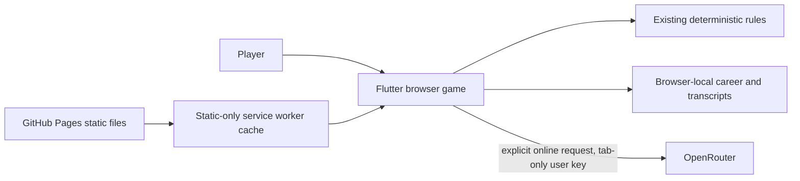

# Psychosims architecture

## Current static web runtime (2026-10-23)

The production entrypoint is `app/lib/main.dart`. It imports the browser game
runtime, the shared deterministic `psycore`/`psychemas` packages, configuration
and the OpenRouter transport. GitHub Pages serves the immutable Flutter build;
it runs no application server, database, API proxy or background worker service.

### Boundaries

- `app/lib/browser/`: browser controller, persistence, navigation and responsive
  screens. Core outcomes, cards, scenario constraints and progression retain
  their existing definitions. Local progression carries no multiplayer authority.
- `app/lib/shared/openrouter*`: validated catalog, in-memory key and bounded
  streaming requests. No server, account login, database or model-file download.
- `packages/psycore/`, `packages/psychemas/`, `config/`: reused game rules,
  structured content, prompt assembly/validation, balance and progression.
- `app/web/`, `scripts/web_build.sh`: static shell, manifest, explicit resource
  inventory and service worker. Every runtime font/renderer/content resource is
  bundled. Cross-origin/API/authenticated requests never enter Cache Storage.
- Retired native/server implementations, binaries and their obsolete tests/docs
  have been removed under explicit user authorization. The shared core and its
  current regression fixtures remain.

### AI and persistence contract

Only deliberate player actions can send new AI requests. Offline AI actions
pause; reconnect does not replay them. Cancellation/failure retains partial
output as incomplete dialogue. An explicit retry requests new text without
re-applying an already resolved mechanical turn. Existing prompt validation
protects required clues and output bounds; model text cannot mutate mechanics.

The API key exists only in memory. It is never in build defines, URLs, browser
storage, service-worker cache, logs or exported game state. Closing/reloading the
tab forgets it. Game state and transcripts intentionally persist locally as
requested; this supersedes the former no-durable-transcripts policy. Browser
storage is origin-scoped, not an encrypted secret vault or cloud backup. Other
people using the same browser profile can access saves, and clearing site data
removes them. Storage errors must be visible and must not falsely report a save.

### Hosting and navigation

The build uses `/` as its base, start URL and scope at `psychosim.com`. Hash
navigation makes deep links and reloads independent of server rewrite rules.
A custom worker caches the complete enumerated build and reports ready only
when installation succeeds. Updates wait until all app tabs close; local saves
are separate from versioned resource caches. See the [hosting guide](../guides/STATIC_HOSTING.md).

### Source adaptations

The browser integration was adapted from
[Worthhit architecture](https://github.com/consciontologic/worthhit/blob/main/docs/ARCHITECTURE.md)
(file blob `3e04dd10e833a668f73096e9099d9b24db84dfb7`),
[wfform chat lifecycle](https://github.com/consciontologic/wfform/blob/main/docs/chat.md)
(file blob `12d56db93240dc2028c22551893b5aca3c2795c0`) and
[wfform transport](https://github.com/consciontologic/wfform/blob/main/lib/features/chat/chat_api.dart)
(file blob `406b7b7b0b1d120aac4cf7469981d64617ec8fa0`), read during implementation.
These are file identities, not repository commit IDs.

Worthhit informed tab-memory credentials, validated current catalog metadata,
static-only caching and privacy defaults. Wfform informed request ownership,
UTF-8/SSE framing, cancellation, separate first-output/idle/overall deadlines,
partial preservation and explicit retry. Psychosims owns a small transport
adapted to its patient dialogue validator; neither repository is a runtime
dependency and neither service's login/backend is included.

Catalog refresh is explicit, unauthenticated and bounded to 30 seconds/4 MiB.
Only unambiguous IDs with valid zero prompt/completion pricing and text input
and output qualify; stale (30-minute), duplicate, changed or removed entries
cannot silently authorize a replacement model. Requests ask for no provider
fallback, no data collection and zero data retention. A provider rejecting this
policy fails visibly rather than silently relaxing it. Completion limits are
90 seconds to first output, 45 seconds idle and 300 seconds overall; the game
bounds accumulated output to 65,536 characters and accepts final dialogue only
under the existing 600-character quality contract. Truncated, malformed,
refused or incomplete output never commits a mechanical turn. These transport
limits and privacy settings do not establish a provider's real-world compliance.

### Exact arithmetic on the web

Dart VM integers and JavaScript integers differ. Full-width PRNG values,
derived seeds, overflow-sensitive fixed-point arithmetic and tax intermediates
use `BigInt` so the browser preserves the original game's trace. The existing
root game seed remains an ordinary safe integer. APIs returning a full-width
seed now return `BigInt`; JSON seed boundaries use exact decimal text where
required, and oversized input is rejected instead of rounded. The committed
pre-port fixture and `scripts/web_core_parity.sh` compare the original VM trace
with both the current VM and compiled JavaScript execution. Historical trusted
catalog proof payloads are unchanged; only source identity hashes are refreshed.
